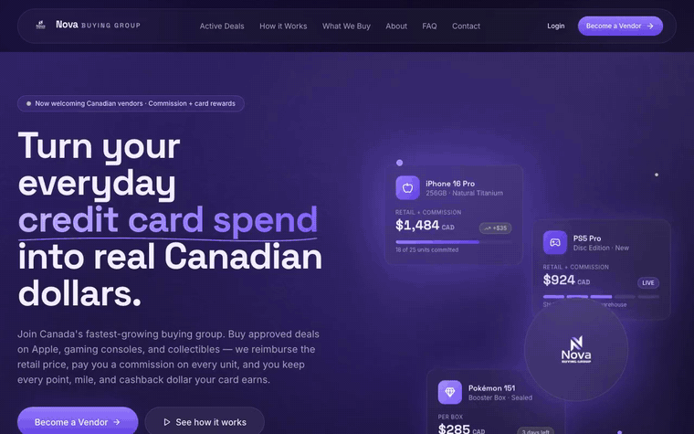
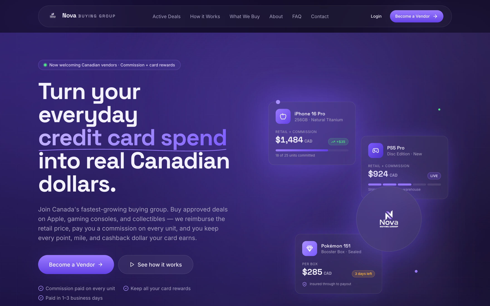
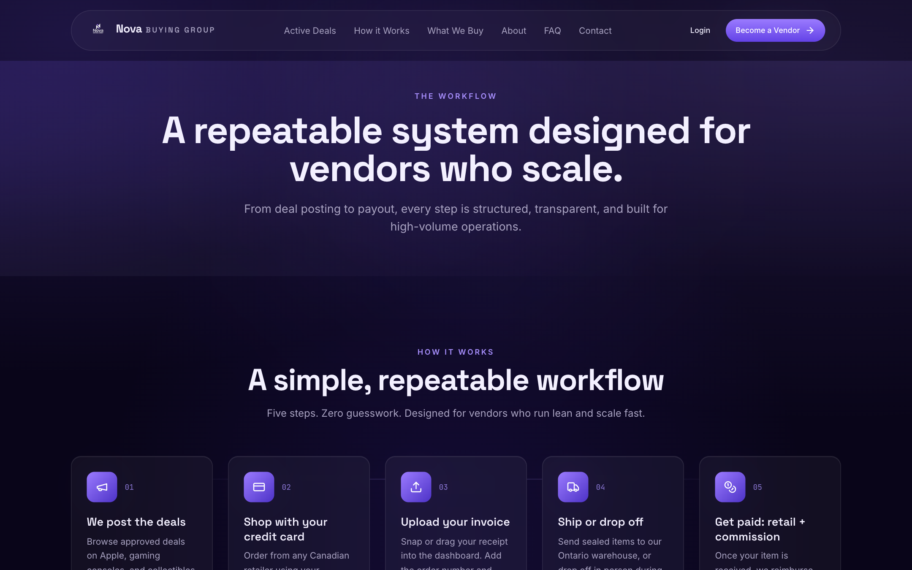
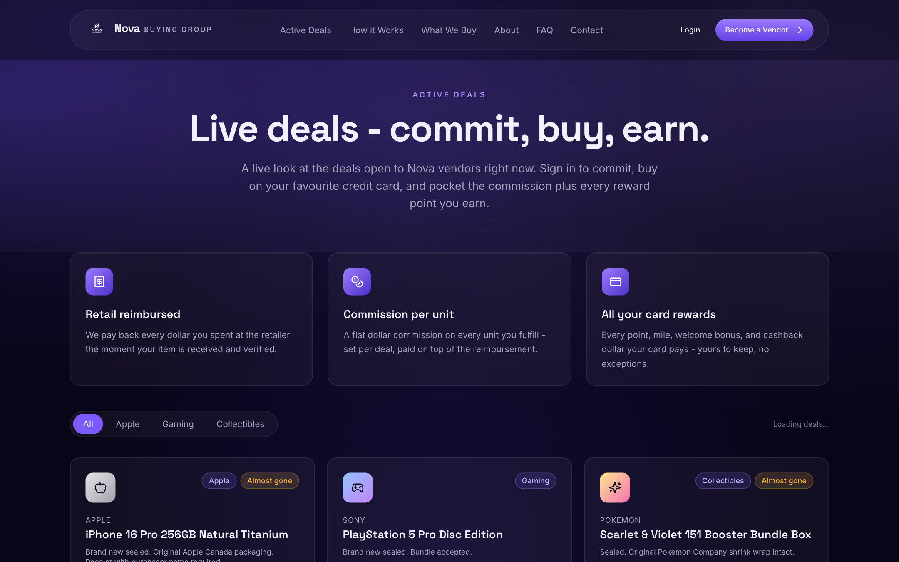
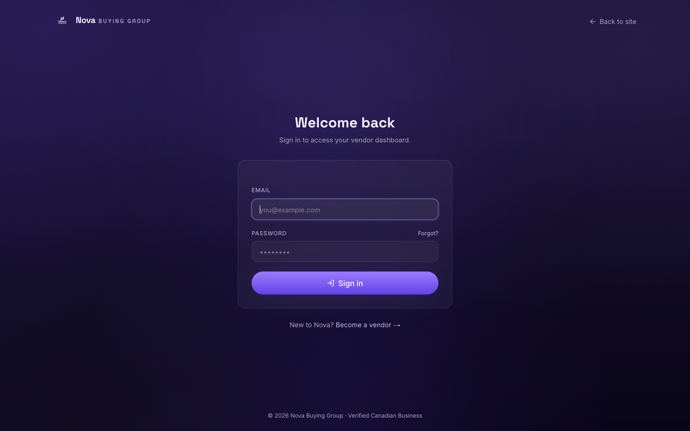
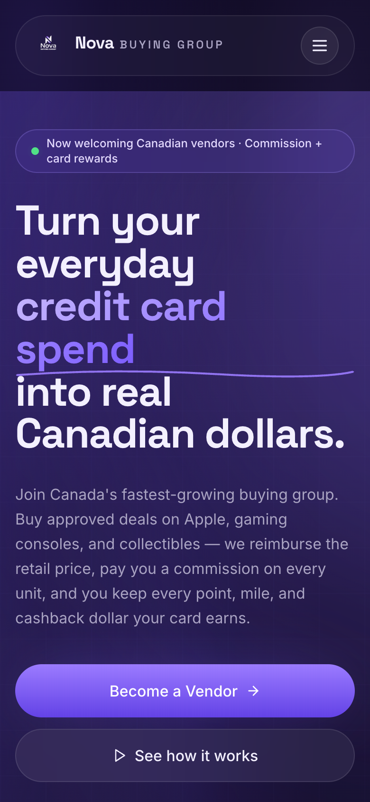

# Nova Buying Group - Buying Group Platform for Apple & Gaming Deals

A platform I built for a buying group where members commit to brand-new Apple, gaming and collectible deals, buy with their own card, ship the sealed units in, and get paid back the retail price plus a per-unit commission — on top of keeping their card rewards.

<a href="media/demo.mp4">Watch the full-quality video</a>

## What it does

**For members**
- Browse active deals and commit to units of a product
- Track each order from commitment through to payout
- Get paid the retail price plus a commission, with payouts, referrals and notifications in one dashboard

**For the team**
- Create and price deals, and approve new vendors
- Receive shipments against commitments and manage inventory
- Handle orders, invoices and payouts, with reporting and a full audit log
- A public deals page and blog for visitors who aren't signed in yet

**Underneath**
- Email sign-in with a one-time code, and a guided onboarding flow
- Database-level security, so deal pricing is only ever visible to approved members, not just hidden in the interface

## Screenshots

**Home page**

**How it works**

**Deals**

**Sign in**

**Mobile layout**

## Tech used

Next.js, React, TypeScript, PostgreSQL with row-level security (via Supabase), and Tailwind CSS.

---

This repository is a public overview only — the platform holds real member and financial data, so the source code is kept private.
